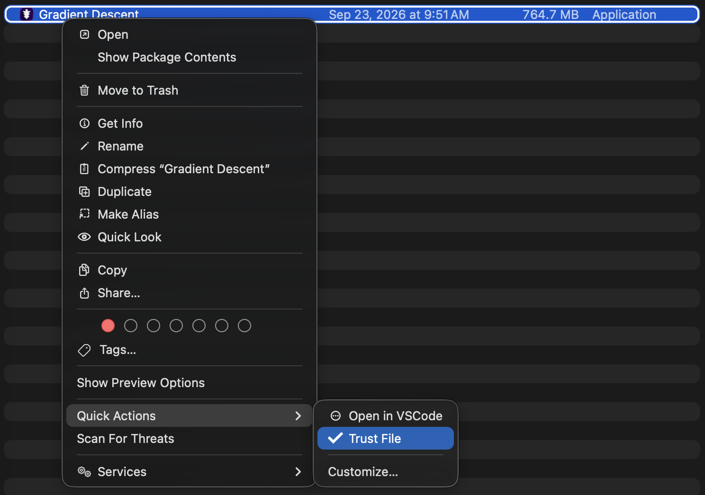

# Trust File

macOS quarantines files downloaded from the internet, and Gatekeeper then blocks them from opening ("cannot be opened because Apple cannot check it for malicious software"). This package adds a **Trust File** option to the Finder context menu (ctrl-click) that removes the quarantine flag.

## Installation

1. run `npx install-trust-file`

The installer enables the option for you. If it doesn't show up, check that it's turned on under `System Settings.app/General/Login Items and Extensions/Finder`.

## Usage



ctrl-click one or more files, folders or `.app` bundles in Finder and choose **Trust File**. A notification confirms success; a dialog lists anything that couldn't be trusted.

If the option is not immediately in the context menu, it is likely under `Services` or `Quick Actions`.

Under the hood this runs:

```sh
xattr -dr com.apple.quarantine <selected items>
```

Folders are processed recursively.

## ⚠️ Only trust what you trust

The quarantine flag is what makes Gatekeeper check a file before it opens. Removing it skips that check, so only use this on files from sources you trust.

## Uninstall

```sh
rm -rf ~/Library/Services/Trust\ File.workflow
```
